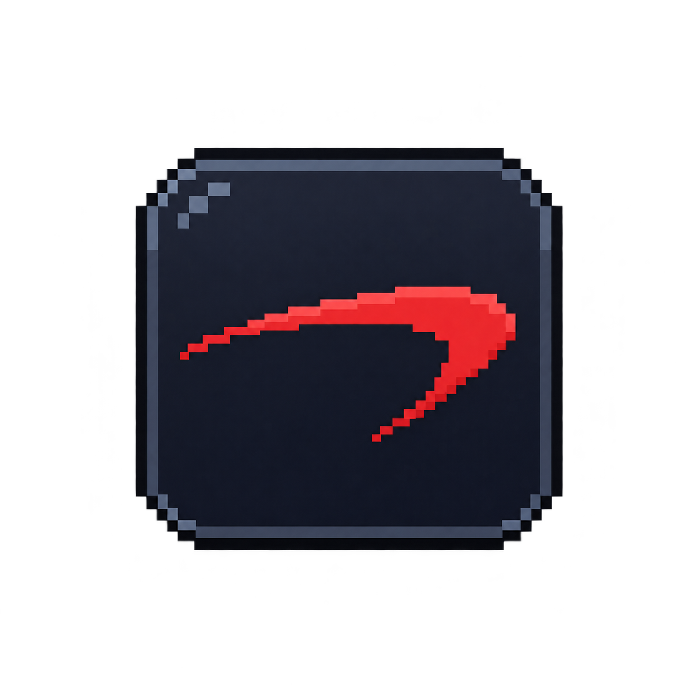

<h3>Experience & Education</h3>

<table border="0" cellspacing="0" cellpadding="0">
  <tr>
    <td align="center" valign="top" width="220" style="border:none;">
       
      <b>Amazon</b> 
      Ring and Blink Cloud Team 
      Winter 2027
    </td>
    <td align="center" valign="top" width="220" style="border:none;">
       
      <b>Capital One</b> 
      Cloud Resiliency Team 
      Summer 2026
    </td>
    <td align="center" valign="top" width="220" style="border:none;">
       
      <b>UMass Amherst</b> 
      BS '27, MS '28
    </td>
  </tr>
</table>

<h3>Selected Projects</h3>

  
   
  
   
  

