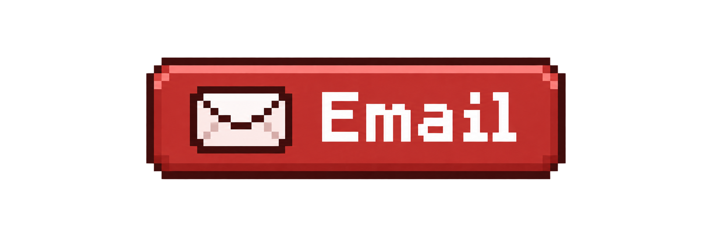

&nbsp;

Hey! I'm Ali, a CS and Math student at UMass Amherst.
I'm joining Amazon this winter after spending last summer
working on cloud resiliency at Capital One.
I love building things that millions of people use and enjoy!

<h3>Experience & Education</h3>

<table>
<tr>
<td align="center" valign="top" width="220">
 
<b>Amazon</b> 
Ring and Blink Cloud Team 
Winter 2027
</td>
<td align="center" valign="top" width="220">
 
<b>Capital One</b> 
Cloud Resiliency Team 
Summer 2026
</td>
<td align="center" valign="top" width="220">
 
<b>UMass Amherst</b> 
BS '27, MS '28 
&nbsp;
</td>
</tr>
</table>

<h3>Selected Projects</h3>

 

 

